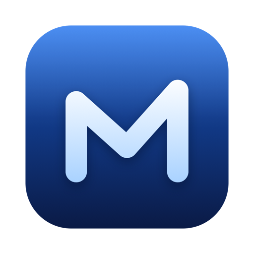

# Moneten

Moneten is an open-source money app for macOS. It keeps your accounts, transactions, and categories in an encrypted database on your Mac, talks to banks directly through FinTS, and connects other services through community extensions.

- [Moneten](https://github.com/MonetenApp/Moneten): the app.
- [moneten-extensions](https://github.com/MonetenApp/moneten-extensions): the catalog of community extensions.

No telemetry, no project server between you and your bank, and no data leaves your Mac except to the banks and services you connect.
